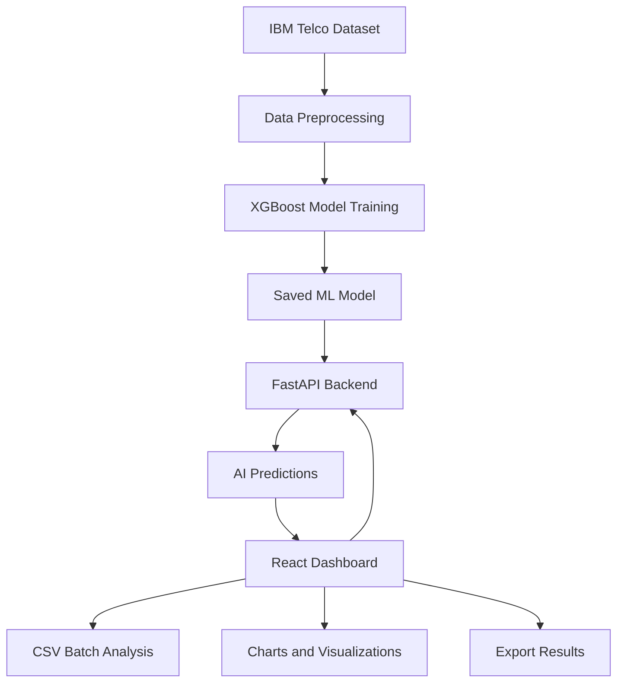

<div align="center">

# ChurnIQ — Customer Churn AI Dashboard

### From Machine Learning to a Full-Stack AI Application

**XGBoost · FastAPI · React · Python · Docker · Machine Learning**


**An end-to-end Machine Learning application for predicting customer churn, analyzing customer data, and visualizing AI-powered insights.**

</div>

---

## About the Project

**ChurnIQ** is a full-stack AI application designed to estimate the probability of customer churn — the likelihood that a customer will cancel their subscription.

The project demonstrates how a Machine Learning model can be integrated into a complete software application using modern development technologies.

Instead of limiting Machine Learning to a Jupyter Notebook, ChurnIQ connects:

- Machine Learning model training
- REST API development
- Interactive frontend development
- Customer data analysis
- Automated testing
- Docker containerization

The application allows users to analyze individual customers or upload CSV files containing multiple customer records.

> **Project Status:** Functional educational AI Engineering prototype. The application is not intended for real-world business decisions without further validation.

---

## Dashboard Preview


The dashboard provides an interactive interface for customer churn prediction and analysis.

### Main Features

- **AI Churn Prediction** — Predict churn risk for individual customers.
- **Interactive Dashboard** — Visualize Machine Learning performance and predictions.
- **Batch Predictions** — Analyze up to 500 customers using CSV files.
- **CSV Export** — Download prediction results for further analysis.
- **Risk Classification** — Identify customers with higher or lower predicted churn risk.
- **Model Performance** — Explore Accuracy, Precision, Recall, F1-Score, and ROC-AUC.
- **REST API** — Access predictions through FastAPI endpoints.
- **Docker Support** — Run the application in containers.

---

## Machine Learning Model

The prediction system uses **XGBoost**, a gradient-boosting algorithm commonly used for classification problems.

### Dataset

The model was trained using the publicly available IBM Telco Customer Churn sample dataset.

**Dataset:** [IBM Telco Customer Churn](https://github.com/IBM/telco-customer-churn-on-icp4d/blob/master/data/Telco-Customer-Churn.csv)

The dataset contains **7,043 customer records** from a fictional telecommunications company.

Customer characteristics include:

- Subscription duration
- Monthly charges
- Contract type
- Internet service
- Technical support
- Online security
- Payment method
- Paperless billing

### Training Process

1. Download and validate the dataset.
2. Preprocess customer information.
3. Encode categorical features.
4. Split the dataset into training and testing sets.
5. Train the XGBoost classification model.
6. Evaluate model performance.
7. Save the trained model and evaluation metadata.
8. Load the model through the FastAPI application.

The model uses an 80/20 stratified train/test split with a fixed random state for reproducibility.

---

## Model Performance

The following results were obtained using a held-out test set of 1,409 customer records.

| Metric | Result |
|---|---:|
| **Accuracy** | **80.62%** |
| **ROC-AUC** | **0.8459** |
| Precision | 67.00% |
| Recall | 53.21% |
| F1-Score | 59.31% |

### Confusion Matrix

| Actual / Predicted | No Churn | Churn |
|---|---:|---:|
| No Churn | 937 | 98 |
| Churn | 175 | 199 |

### Model Interpretation

The model achieves an overall classification accuracy of **80.62%**.

However, the recall score of **53.21%** indicates that some customers who actually churn are not identified by the model.

This highlights an important Machine Learning lesson:

**Accuracy alone is not enough to evaluate a classification model.**

Future improvements will focus on increasing recall, evaluating decision thresholds, and improving model reliability.

These metrics represent performance on the sample dataset, not guaranteed performance on real customers.

---

## System Architecture



### Technology Stack

| Component | Technologies |
|---|---|
| Programming Language | Python |
| Machine Learning | XGBoost, scikit-learn |
| Data Processing | Pandas |
| Backend | FastAPI, Pydantic, Uvicorn |
| Frontend | React, JavaScript, Vite |
| Data Visualization | Recharts |
| Testing | Pytest, Node.js Test Runner |
| Containerization | Docker, Docker Compose |
| Version Control | Git, GitHub |
| CI | GitHub Actions |

---

## Application Features

### 1. Individual Customer Prediction

Users can enter customer information directly into the dashboard.

The application sends the information to the FastAPI backend, which processes the data using the trained XGBoost model.

Example API response:

```json
{
  "prediction": 1,
  "probability": 0.529519,
  "message": "Higher churn risk",
  "model_version": "2.0.0"
}
```

The estimated churn risk for this example is approximately **52.95%**.

The model uses a classification threshold of 0.50.

The V3 application currently uses the previously trained V2.0.0 Machine Learning model.

### 2. Batch Customer Analysis

ChurnIQ supports CSV uploads containing up to **500 customer records**.

The application processes the records and provides:

- Individual churn predictions
- Estimated churn risk scores
- Higher-risk customer counts
- Lower-risk customer counts
- Exportable prediction results

### 3. CSV Export

Users can download the results as a CSV file.

The exported file includes the original customer information alongside:

- `prediction`
- `churn_probability`
- `risk_label`

### 4. Model Performance Dashboard

The dashboard displays Machine Learning evaluation metrics through interactive visualizations.

This allows users to understand how the model performs on the test dataset.

---

## Installation and Setup

### Requirements

- Python 3.11
- Node.js 20+
- npm
- Git
- Docker (optional)

### Step 1 — Clone the Repository

```bash
git clone https://github.com/SinanKC35/Customer_Churn_AI.git

cd Customer_Churn_AI
```

### Step 2 — Create a Python Virtual Environment

```bash
python3.11 -m venv .venv

source .venv/bin/activate
```

### Step 3 — Install Python Dependencies

```bash
python -m pip install -r requirements-dev.txt
```

### Step 4 — Train the Machine Learning Model

```bash
python train.py
```

This command downloads the sample dataset, trains the XGBoost model, evaluates its performance, and saves the trained model locally.

### Step 5 — Start the FastAPI Backend

```bash
python -m uvicorn app.main:app --port 8000
```

API documentation:

http://127.0.0.1:8000/docs

### Step 6 — Start the React Frontend

Open a second terminal:

```bash
cd frontend

npm ci

npm run dev
```

Open the dashboard:

http://127.0.0.1:5173

Both backend and frontend must be running for predictions to work.

---

## Docker Deployment

The project also supports containerized execution.

From the project root:

```bash
docker compose up --build
```

The Docker Compose configuration runs the frontend and backend services together.

Open:

http://127.0.0.1:8080

Stop the services:

```bash
docker compose down
```

**Note:** The complete V3 Docker Compose deployment should be verified on the target machine before production use.

---

## API Endpoints

| Method | Endpoint | Description |
|---|---|---|
| GET | `/health` | API health check |
| GET | `/ready` | Model readiness status |
| GET | `/model-info` | Model performance information |
| POST | `/predict` | Individual churn prediction |
| POST | `/predict-batch` | Batch customer predictions |
| GET | `/docs` | Interactive API documentation |

---

## Automated Testing

Automated tests are used to verify application functionality.

### Backend Tests

```bash
python -m pytest -v
```

**Result: 14/14 tests passed**

Tests cover:

- API health
- Input validation
- Model readiness
- Individual predictions
- Batch predictions
- Feature encoding
- Error handling

### Frontend Tests

```bash
cd frontend

npm test
```

**Result: 5/5 tests passed**

Tests cover:

- CSV parsing
- CSV validation
- Quoted values
- Batch size validation
- CSV export safety

### Frontend Production Build

```bash
npm run build
```

The frontend production build completed successfully with Vite 6.4.4.

### Dependency Security

```bash
npm audit
```

The latest local dependency audit reported **0 known vulnerabilities** after updating Vite.

Passing tests and dependency audits does not guarantee that the application is free of bugs or security vulnerabilities.

---

## Project Structure

```text
Customer_Churn_AI/
│
├── app/
│   └── FastAPI backend and ML inference
│
├── frontend/
│   ├── src/
│   ├── tests/
│   ├── Dockerfile
│   └── nginx.conf
│
├── tests/
│   └── Python automated tests
│
├── assets/
│   └── Dashboard screenshots
│
├── examples/
│   └── Sample customer CSV
│
├── .github/
│   └── workflows/
│
├── train.py
├── Dockerfile
├── docker-compose.yml
├── requirements.txt
├── requirements-dev.txt
├── CHANGELOG.md
└── README.md
```

Generated model files, datasets, virtual environments, and installed frontend dependencies are excluded from version control.

---

## Future Improvements

Planned improvements include:

- Improve model recall and F1-score
- Hyperparameter optimization
- Cross-validation and probability calibration
- Explainable AI using SHAP
- Feature importance visualizations
- Model monitoring and drift detection
- Authentication and user management
- Cloud deployment
- Public live demo using fictional customer data

---

## Project Purpose

This project was developed as part of my personal learning journey in **Artificial Intelligence and Machine Learning Engineering**.

The main goal was to understand how a Machine Learning model can be transformed into a complete application that connects data processing, model training, backend development, and an interactive frontend.

Through this project, I gained practical experience with Python, XGBoost, FastAPI, React, Docker, and automated testing.

---

## Author

**Sinan Kioutsouk**

Informatics & Telecommunications Student  
National and Kapodistrian University of Athens (NKUA)

Interested in **Artificial Intelligence, Machine Learning, and AI Engineering**.

- **GitHub:** https://github.com/SinanKC35
- **LinkedIn:** https://www.linkedin.com/in/kioutsouk/

---

<div align="center">

**Built with Python, XGBoost, FastAPI, React, and Docker.**

*From Machine Learning experiments to real software applications.*

</div>
