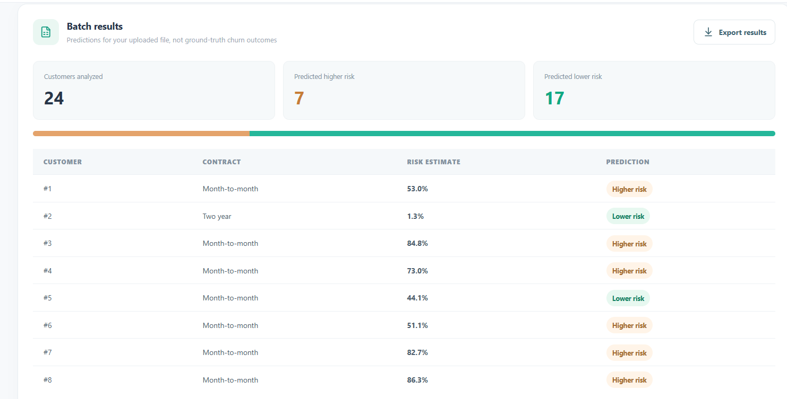
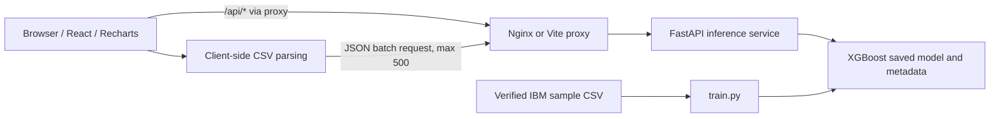

# ChurnIQ — Customer Churn Prediction Dashboard

**An end-to-end ML portfolio project by [@SinanKC35](https://github.com/SinanKC35)** — from XGBoost model training to a React dashboard with FastAPI and Docker.

**Full-stack, educational AI Engineering portfolio:** React + Recharts dashboard, XGBoost machine learning, FastAPI inference, bounded batch CSV predictions, automated tests, and Docker packaging.

[](https://www.python.org/)
[](https://fastapi.tiangolo.com/)
[](https://react.dev/)
[](https://docs.docker.com/compose/)

**Scope:** This is an **educational portfolio prototype**, not a deployed, production-validated retention system. The IBM sample represents a *fictional* telecom company. The model's probabilities are uncalibrated and should not be treated as verified real-world probabilities.

## Dashboard preview



The screenshot shows an actual local test run with **24 fictional customers**, including predicted churn-risk scores. These are model outputs, not observed customer departures.

**Quick tour:** open the dashboard locally, test a single prediction, upload [`examples/sample_customers.csv`](examples/sample_customers.csv), run batch predictions, and export the result CSV. The sample file contains **fictional demo records only**.

> **Live demo:** not hosted publicly yet. This repository includes local development and Docker instructions, but `localhost` URLs work only on the machine running the application.

## What's new in V3

- Responsive React dashboard with a customer input form linked to the **real** FastAPI `/predict` endpoint.
- Visual model performance cards and bar chart populated dynamically from `/model-info` (not hardcoded statistics).
- Confusion matrix populated from saved model metadata.
- CSV batch predictions for **up to 500 customers** in a single validated request, with previews and CSV results export.
- Downloadable valid CSV template and detailed input errors.
- A simple Docker Compose deployment for Nginx (dashboard) and FastAPI (model).
- Original 10 passing backend tests preserved, plus **4 new batch backend tests** and **5 CSV parser/export tests**.

## Screens / features

| Section | Feature | Source |
| --- | --- | --- |
| Overview | Accuracy, ROC-AUC, Recall, F1 | `GET /model-info` |
| Single prediction | Churn risk, predicted label, model version | `POST /predict` |
| Batch predictions | CSV upload, summary, detailed export | `POST /predict-batch` |
| Model performance | Bar chart and confusion matrix | `GET /model-info` |

**Data privacy for this demo:** CSV content is parsed inside the user's browser and submitted as JSON to their configured FastAPI endpoint. No customer dataset is intentionally written to disk by the API. Deploying this beyond localhost would require proper security controls and privacy analysis.

## Model and real measured results

The IBM Telco Customer Churn sample has **7,043 rows** (fictional company). An XGBoost classifier is trained using a stratified 80/20 split, with 1,409 held-out rows. The same V2.0.0 trained model and its evaluation logic are retained in V3.

| Metric | Held-out test |
| --- | ---: |
| Accuracy | **80.62%** |
| ROC-AUC | **0.8459** |
| Precision | 67.00% |
| Recall | 53.21% |
| F1 | 59.31% |

Confusion matrix, actual × predicted: `[[937, 98], [175, 199]]`. The model identifies **199 of 374** actual churn cases and misses 175, so this is *not* ready for automated retention decisions in a real company.

**Important:** The dashboard does **not** retrain, tune, or improve the ML model by itself. Its purpose is to provide a functional user interface for the existing verified inference API.

## Architecture



## Option A: Run in VS Code / WSL (two terminals)

Use **Python 3.11** and **Node.js 20 or later**. If you already created `~/venvs/customer-churn-v2`, reuse it.

**Terminal 1 — API:**

```bash
cd Customer_Churn_AI_Dashboard_V3
source ~/venvs/customer-churn-v2/bin/activate
python -m pip install -r requirements-dev.txt
python train.py
python -m pytest -q
python -m uvicorn app.main:app --host 127.0.0.1 --port 8000
```

Training downloads the verified IBM sample the first time and saves artifacts under `models/`. You can instead copy matching V2 artifacts from your previous installation, but `python train.py` is the straightforward reproducible option. Leave this terminal running.

**Terminal 2 — frontend:**

```bash
cd Customer_Churn_AI_Dashboard_V3/frontend
npm install
npm test
npm run dev
```

Open **http://127.0.0.1:5173**. Vite proxies `/api/*` requests to the Python server at `http://127.0.0.1:8000`. Run the React dashboard at `5173`, **not** the Swagger API URL. The Swagger API is still available at http://127.0.0.1:8000/docs.

> **WSL performance:** Installing npm dependencies under `/mnt/c/` can be slow. For faster installs, copy this project inside Ubuntu (e.g. `~/projects/churn-dashboard`) before running `npm install`.

> If you change frontend dependencies, regenerate and commit `frontend/package-lock.json` after `npm install`. It makes future installs reproducible and lets CI use `npm ci`.

## Option B: Docker Compose (single command)

If your WSL Docker Engine and Compose plugin are available:

```bash
sudo docker compose up --build
```

Then open **http://127.0.0.1:8080**. The dashboard is exposed **only on your local machine**, with Nginx proxying calls to the private FastAPI service. The backend image retrains its model from the checksum-verified IBM sample during the Docker build, so the first build requires internet access.

Stop with `Ctrl+C` and then `sudo docker compose down`. If `docker compose` is unavailable in your Ubuntu distribution, install the `docker-compose-v2` package (or follow official Docker Compose installation instructions).

**Docker architecture:** `api` uses the existing non-root FastAPI Dockerfile; `dashboard` uses a multi-stage Node build and Nginx static server. Ports: public localhost `8080` → Nginx `80`; the Python service is internal at `api:8000`.

## CSV template and fields

Use the **Download template** button. The nine required columns are:

```
tenure,monthly_charges,senior_citizen,contract,internet_service,payment_method,tech_support,online_security,paperless_billing
```

- `tenure`: months, integer `0`–`120`.
- `monthly_charges`: nonnegative, `0`–`250`, **dataset USD units**.
- `senior_citizen`: integer `0` or `1`.
- Allowed categories match the validated API schema.
- If `internet_service = No`, both `tech_support` and `online_security` must equal `No internet service`.
- 500 customer rows / 2 MB maximum per browser upload. Invalid rows are rejected rather than silently skipped.

The CSV export adds `prediction`, `churn_probability`, and `risk_label` for every submitted row. Upload summary counts are **predicted labels**, not actual observed customer departures.

## API endpoints

| Method | Route | Purpose |
| --- | --- | --- |
| `GET` | `/health` | Process liveness |
| `GET` | `/ready` | Model readiness (503 if model unavailable) |
| `GET` | `/model-info` | Real evaluation metadata |
| `POST` | `/predict` | Single validated customer prediction |
| `POST` | `/predict-batch` | 1–500 validated customers, vectorized inference |
| `GET` | `/docs` | Interactive OpenAPI documentation |

**Example batch request:**

```json
{
  "customers": [
    {
      "tenure": 24,
      "monthly_charges": 79.5,
      "senior_citizen": 0,
      "contract": "Month-to-month",
      "internet_service": "Fiber optic",
      "payment_method": "Electronic check",
      "tech_support": "No",
      "online_security": "No",
      "paperless_billing": "Yes"
    }
  ]
}
```

All browser requests use the same-origin `/api` proxy. The FastAPI API has no permissive `Access-Control-Allow-Origin: *` setting in this demo.

## Tests

```bash
python -m pytest -q    # backend tests, including batch inference
cd frontend
node --test tests/*.test.js   # CSV logic tests without npm dependencies
npm test                  # same tests via npm
npm run build             # requires npm install
```

This release has **14 passing Python tests** and **5 passing Node CSV tests**, locally checked in the authoring environment. JSX syntax was checked separately. **A live `npm run build` and full Docker Compose launch have not been executed in the authoring environment because npm registry access is unavailable there.** Verify both before announcing a deployed dashboard.

The GitHub Actions workflows in `.github/workflows/` are configured to run the Python tests and build/test the React frontend when pushed; check their real status in your GitHub repository's Actions tab.

## File tree

```text
app/                         # FastAPI, model loading and inference
frontend/
  src/App.jsx                # React dashboard UI
  src/styles.css             # responsive styles
  src/api.js                 # same-origin API client
  src/csv.js                 # CSV parsing, template, export
  tests/csv.test.js          # frontend utility tests
  Dockerfile / nginx.conf    # production dashboard container
train.py                     # XGBoost training with verified dataset
models/                      # generated locally, excluded from Git
.github/workflows/           # backend tests and frontend build
Dockerfile                   # backend image, non-root user
docker-compose.yml           # integrated frontend + backend
```

## Known limitations

- This is a sample-data, educational model; real deployment needs external validation, threshold optimization, calibration, security, privacy controls, monitoring, and fairness evaluation.
- No authentication: **do not expose it publicly** or upload sensitive real customer data without safeguards.
- Dashboard charts describe the held-out IBM test set; they are not analytics based on uploaded CSV customer outcomes.
- No persistent database or production hosting is included.

Read [START_HERE_GR.md](START_HERE_GR.md) for simple Greek setup instructions. Version history: [CHANGELOG.md](CHANGELOG.md).

## Author

Developed as an independent AI Engineering portfolio project.

- GitHub: [@SinanKC35](https://github.com/SinanKC35)
- LinkedIn: [LinkedIn profile](https://www.linkedin.com/in/kioutsouk/)

**Code reuse:** A public repository can be viewed and forked. No open-source license is bundled with this portfolio package; please choose and add a license explicitly if you want to grant reuse rights.
